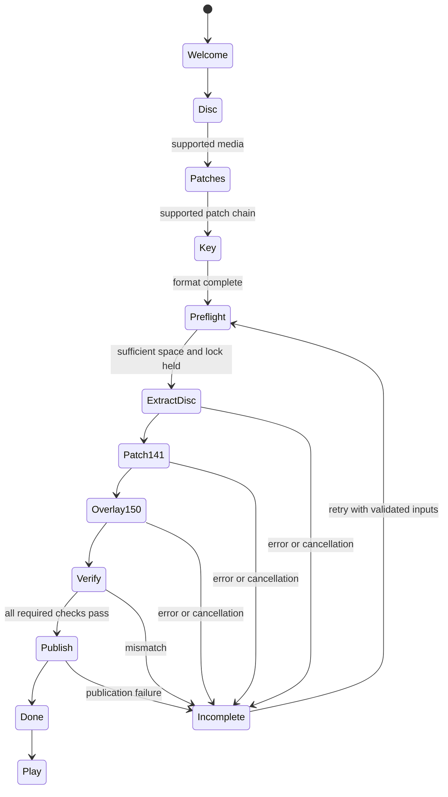

# Native macOS setup design

Historical prototype snapshot. Current build, decisions and results are in
[README](../README.md), [setup-design.md](setup-design.md) and
the project notes. Original repository links below are historical.

`[CHOSEN, not recovered]` This design implements the owner's installation decisions
of 2026-11-10. That request authorizes this intentional port work in place of an
issue, as [macos-port.md](macos-port.md) describes. It changes no recovered engine
behavior, ABI, packet format or game file format. The prototype and measured results
are described in [macos-mac-setup.md](macos-mac-setup.md).

Distribute a DMG containing **Battlefield 2.app** and an Applications shortcut.
The user drags the app into Applications and launches it. Setup belongs inside
that app. There is no separate installer app, package installer, administrator
helper or destination-folder chooser. The app does not redistribute game data.
All extraction and patch application are native; neither Wine nor Python is a
runtime dependency.

## Screens and state

The proposed host is AppKit, with an `NSWindow` and a view controller for each
screen. This works with the port's macOS 11 deployment target and existing
Objective-C++ host. SwiftUI can wrap the same controller later. No wizard window
has been implemented in this package.

| Screen | Content and transition |
| --- | --- |
| Welcome | Explain that the user supplies their BF2 DVD/ISO and the two official patch files. Continue opens Disc. An existing verified data receipt opens Play instead. |
| Disc | Choose ISO with `NSOpenPanel`, choose a mounted DVD volume, or drag either into the drop area. Show detected edition/language and validate the cabinet inventory before enabling Continue. Unsupported editions remain here with a specific explanation. |
| Patches | Two labeled file wells: 1.00 → 1.41 and 1.41 → 1.50. Drag/drop and Choose both work. Check container shape and SHA-256 against the supported-media catalog; swapped or wrong patches disable Continue. |
| CD key | Five fields of four ASCII alphanumeric characters per product. Auto-advance, backspace and whole-key paste work within each row. Per the 2026-11-10 owner decision, independently reconstruct the retail local check; require BF2 and, for Deluxe, SF to validate before Install. Show live row status. No key generation or online authentication claim. See [provenance](cdkey-check.md). |
| Install | Show phases, current file, completed/total expanded bytes, estimated remaining disk use, and Cancel. Worker callbacks update the main thread. Disable Back while writes are active. A failure offers Retry or Return to the relevant input screen. |
| Done | Reached only after extraction, patching, content verification and publication all pass. Show Play. Launch the native bundled client with the verified content root and existing profile location. |

State model:



The key is held in memory until the user starts setup. Save it only with private
file permissions, outside diagnostic logs and receipts. Preserve existing
`Registry.con` entries and profiles; update the BF2 `ergc` value atomically using
the existing [registry-file syntax](macos-r1-registry-file.md). That source expects
unmarked key text. Do not write a Windows DPAPI blob or silently introduce a new
key storage format. Keep `Registry.con` mode 0600 and its parent mode 0700. Logs
must never contain the entered key, including failed paste contents.

## Content pipeline

```text
user's read-only ISO or DVD
  → ISO/Joliet ranges (or mounted-volume files)
  → data1.hdr + data1.cab/data2.cab, InstallShield format 9
  → private disc staging tree, expanded-size and MD5 checks
user's 1.41 patch.exe
  → bounded PE32 SFX overlay ranges
  → Disk1/bf2/PATCH.RTP, version 0x0320
  → rtptool history selection + per-step source/destination checksums
  → 1.41 staging tree
user's 1.50 patch.exe
  → bounded PE32 SFX overlay ranges
  → format-9 cabinets, full replacement files
  → 1.50 staging tree
  → required-content manifest + full file inventory/hash verification
  → atomic publication + content receipt
```

The verified SFX format is a repeated ANSI basename, Windows path, version and
ASCII decimal payload length, each NUL terminated, followed by exactly that many
payload bytes. Parsing starts after the last PE section and must end exactly at
EOF. It does not execute a Windows EXE. Cabinet decompression is block-framed raw
DEFLATE with zlib; decoded lengths and stored MD5s must match. Checksums detect
corruption; publisher-origin checks belong to a separately maintained trusted
input catalog.

The installer probe (`agent/installer-probe:docs/macos-installer-probe.md`)
established that disc + 1.50 is incomplete. Its 125-path set includes map ZIPs,
co-op metadata, Python modules, common archives and other earlier additions.
The exact InstallScript version predicate is not proven and is unnecessary for
this extraction design: accept only verified input variants and the verified
patch chain. No registry-version bypass substitutes for missing content.

For the supported BF2 base-game installation, apply BF2's RTP payload. Do not
apply `xp1` without Special Forces base media. The `bp1`/`bp2` patches require
their earlier source files; 1.50 supplies their relevant full replacements for
this base-game configuration. The prototype does not claim an SF installation,
Deluxe-disc support, non-English setup feature parity, original timestamps or
Windows installer side effects. The ALT+TAB hotfix is a Windows binary change,
outside this native data-install path.

The current full-record BF2 application has explicit failures outside the
125-path acceptance set. A release installer must classify every record against
a reviewed final-content contract, including historical developer/server paths
and terminal deletions. Until then, report incomplete and refuse Done/Play.
Passing the 125-path test alone does not publish an installation.

## Modules and source layout

The prototype lives under `tools/macos/setup/`, separate from engine image
manifests and the earlier standalone `tools/macos/installer/` work.

| Module | Responsibility and current implementation |
| --- | --- |
| `Installer.h` / `Containers.cpp` | Read-only shared range handles; ISO/Joliet directories; PE32 SFX records; format-9 descriptors, groups, links and streaming DEFLATE/MD5. |
| `Installer.cpp` | Chosen English feature mapping, fresh staging, BF2 RTP application, full SHA-256 comparison and independent 125-path acceptance. |
| `RtpBridge.h` / `rtp-bridge/` | Opaque C handle, record names, checked application and explicit byte-buffer ownership. Rust panics become error results at the C boundary. |
| `vendor/rtptool/` | Unmodified pinned owner-fork source, MIT license, lockfile and format notes. |
| `main.cpp` | Diagnostic CLI: inspect ISO/SFX, prototype the complete data chain, or compare trees. |
| `Code/Tests/macos_setup.cpp` | Synthetic bounded-read, path, SFX truncation/trailer, symlink and C ABI rejection checks. No game content. |
| Future `SetupController.mm` | Wizard state, background work, cancellation, progress, journal and launch handoff. Design only. |
| Future `SetupReceipt` | Versioned input/output hashes, completion state and selected data location. Never keys or copied game bytes. Design only. |

The prototype reads ISO/Joliet directly, so it needs no mount or helper process.
Mounted DVD folders need a future directory-backed input provider. Other image
formats can later use `/usr/bin/hdiutil attach -readonly -nobrowse` with an
app-owned mountpoint and unconditional detach on exit. Do not unmount an owner's
preexisting volume. A libarchive provider is another option, but the local
`bsdtar` returned an empty listing for the actual bridge ISO during the probe;
do not treat that as an empty disc. Current support is explicit and narrow.

### Cabinet implementation and unshield

No local unshield source or executable was available. Following the owner's
fallback, this package implements the needed cabinet reader in C++ from the
verified Python field/layout notes. The new setup code is offered under MIT
(see its `LICENSE`); third-party source keeps its own attribution. It supports
the observed `0x01009500` cabinet version only, rejects unsupported storage and
encodings, and does not claim to be a general InstallShield library.

If unshield replaces this reader later, vendor a reviewed immutable upstream
revision and its MIT notice in `vendor/unshield`. Build a static library in-tree;
do not require users to install a package manager or command. Upstream's
[CMake configuration](https://github.com/twogood/unshield/blob/main/CMakeLists.txt)
provides `BUILD_STATIC` and `USE_OUR_OWN_MD5`. Prefer its own MD5 path to an
additional bundled OpenSSL dependency; link the SDK zlib. With sources already
available, the intended separate build is:

```sh
cmake -S vendor/unshield -B out/unshield-universal -G 'Unix Makefiles' \
  -DCMAKE_OSX_ARCHITECTURES='arm64;x86_64' \
  -DCMAKE_OSX_DEPLOYMENT_TARGET=11.0 \
  -DBUILD_STATIC=ON -DUSE_OUR_OWN_MD5=ON
cmake --build out/unshield-universal -j4
```

This is a future integration recipe, not a build performed here. Keep the
bounded-range adapter, staging/path controls and manifest verification regardless
of the cabinet backend.

### rtptool and universal builds

The owner's rtptool fork carries the `bf2-0x0320` branch. The vendored source is pinned to
`101433150a37001c74823659f56391723378e0b0` from that branch, not main. No upstream
source was modified. `rtp-bridge` depends on this path with default features off,
so clap and the CLI are absent. It calls `apply_record`, which verifies history
source selection and every destination; checksum bypass is unavailable.

CMake builds `staticlib` with `cargo --offline --locked`
for each target slice and merges them with `lipo`. The generated archive links
into the native C++ CLI, and eventually into the app. There is no Rust toolchain
dependency on the user's machine. `thiserror` and proc-macro dependencies are
pinned by the bridge lockfile; this machine's existing Cargo cache supplied them.
Their notices are retained in `THIRD-PARTY-NOTICES.txt`. A clean offline build
machine needs these locked crates preseeded or vendored beforehand.

```sh
cmake --preset macos-x64 -B out/build/mac-setup
cmake --build out/build/mac-setup --target bf2_setup bf2_setup_checks -j4

# Requires both Rust standard libraries already present; installs nothing.
cmake --preset macos-universal -B out/build/mac-setup-universal
cmake --build out/build/mac-setup-universal --target bf2_setup -j4
```

The two Rust targets are `x86_64-apple-darwin` and `aarch64-apple-darwin`.
For a release, the native client, setup host/core, optional cabinet helper and
all bundled dylibs must have both slices. Validate with `lipo -archs` on every
Mach-O and test the resulting app on both machines. `arm64` compilation alone is
not an Apple silicon runtime result. This machine currently lacks the arm64 Rust
standard library; no installation was attempted, and the universal prototype
does not yet link. Cross-compilation of the C++ sources is reported separately.

## Bundle and writable data

Recommended immutable bundle:

```text
Battlefield 2.app/Contents/
  Info.plist
  MacOS/Battlefield 2              native launcher and in-app setup host
  MacOS/bf2_client                 native universal engine
  Frameworks/libdice_py.dylib      native embedded engine runtime
  Frameworks/libaidll.dylib        other required native libraries
  Resources/Setup/                 input catalogs, UI resources, licences
  Resources/                      original OpenBF2-owned resources only
```

The setup C++/Rust libraries should be statically linked into the launcher; the
CLI is a developer target. If setup is isolated in a helper later, put that
universal executable in an appropriate nested-code location and sign it. Setup
does not use Python. The engine's existing native embedded Python runtime is a
separate game dependency, not a system-Python requirement for installation.
Apple documents code/resource placement in
[Placing content in a bundle](https://developer.apple.com/documentation/bundleresources/placing-content-in-a-bundle).

Proposed external layout:

```text
~/Library/Application Support/OpenBF2/
  Registry.con                    existing registry replacement, private
  Profiles/                       existing client profiles
  ProtectedData.key               existing protected-profile key
  GameData/1.50/                   verified installed game data
  Setup/staging/<transaction>/     incomplete, private work
  Setup/receipts/<transaction>.json
  Setup/Current.json               atomically replaced active receipt
  Setup/Install.lock
  FxNative/                       existing native shader-cache location
```

The launcher resolves the receipt and sets the client's working directory to
the verified data root. The engine's `@HOME@` remains the existing OpenBF2 support
directory. Retail PE/DLL files extracted for completeness are data: never load
them as native code. Native libraries resolve from the signed bundle.

### Location decision

| Concern | `Contents/Resources/GameData` inside the app | `~/Library/Application Support/OpenBF2/GameData` |
| --- | --- | --- |
| Signature seal | Creating or replacing bundled data after signing changes the resource seal. | Setup leaves signed app resources untouched. |
| Local ad-hoc signing | Requires re-signing the final modified outer bundle; retain appropriate nested signatures. This no longer has the distributed Developer ID identity/ticket relationship. | Unnecessary for content installation. |
| Notarization | The user's unique modified bundle cannot inherit the original notarized artifact's integrity. The developer cannot notarize every owner-generated bundle. | Notarize and update the unchanged app independently of user data. |
| `/Applications` writes | Filesystem ownership/read-only volumes and App Management policy may prevent writes or prompt, particularly for a separate helper modifying the app. Exact self-write behavior needs a signed-app test on supported macOS versions. | Per-user writable location; no modification of an Applications bundle. |
| Updates | Drag-replacing the app can delete many gigabytes of user-installed data; an updater must migrate/reverify it and reseal the result. | Replace the app while retaining verified data and profiles. Version receipts allow explicit data migrations. |
| Users and removal | Potential single shared copy, but key/profile data must remain per user. Deleting the app also removes data. | Per-user data copies; deleting the app leaves data until the owner chooses to remove it. |
| Finder experience | One large, apparently self-contained application. | Small application; a Reveal Game Data action can expose the managed directory. |

**Recommend Application Support**, with one fixed managed data location and no
folder picker. Apple recommends Application Support for app-managed persistent
support files in its
[filesystem guidance](https://developer.apple.com/documentation/foundation/using-the-file-system-effectively).
The owner still makes this decision; the prototype publishes to neither location.

Writing into a signed bundle breaks its seal; ad-hoc signing can produce a new
local seal but cannot preserve the developer's signature. These consequences
follow Apple's [TN2206](https://developer.apple.com/library/archive/technotes/tn2206/)
and [notarization requirements](https://developer.apple.com/documentation/security/resolving-common-notarization-issues).
Do not strip quarantine, disable Gatekeeper, request broad disk access or make
re-signing part of the default user flow.

macOS exposes App Management permission for modifying applications; the exact
permission outcome for a signed app modifying itself versus a separate helper
has not been tested here. Treat bundle writes as a deployment risk requiring a
target-version experiment, not as guaranteed to succeed or guaranteed to prompt.
See Apple's [Privacy & Security settings](https://support.apple.com/guide/mac-help/change-privacy-security-settings-mchl211c911f/mac).

Release flow: build all universal slices, put code in standard locations, sign
nested native code from the inside out with Developer ID and hardened runtime,
sign the app, verify strictly, create/sign the DMG, notarize and staple the
appropriate artifacts, then test offline launch from a fresh drag-copy. Audit
runtime entitlements against the actual client; do not add disable-library-
validation by default. No signing identity was used, no DMG built, and no
notarization submitted in this prototype.

## Failure handling and publication

| Condition | Required behavior |
| --- | --- |
| Wrong/unsupported DVD or ISO | Show detected inventory/edition and ask for supported media. No writes to the source and no attempt to interpret unknown compression. |
| Wrong/swapped/corrupt patch | Identify the affected patch field and phase. Reject range, EOF, expanded-length and checksum failures. Never execute the patch launcher or disable checksums. |
| Missing source version in RTP history | Report the exact target and missing compatible source. Keep setup incomplete; do not use the installed reference to fill the gap. |
| Insufficient disk space | Before writes, sum selected expanded cabinet sizes plus staging and largest patch source/program/destination working sets, old installed data retained for rollback, and a reserve. Check the destination volume. Continue checking ENOSPC/write/close errors during extraction. The prototype uses a conservative 16 GiB free-space threshold, not this production estimator. |
| Cancellation/interruption | Cancel between chunks/records, discard the active `.part`, keep the previous published installation. A durable journal records complete phases, input identities and output hashes; resume rechecks them and restarts the incomplete phase. The prototype supports fresh runs only. |
| Wrong checksum or final manifest mismatch | Stop before publication and keep a redacted diagnostic report. Never expose Done or label an incomplete tree 1.50. |
| Concurrent setup/client | Hold a setup lock and coordinate with the client's existing lock. Refuse publication while a client uses the active generation. |
| Permission/read-only destination | Explain the failed destination and offer retry; never elevate or silently choose a different directory. |
| Removal/rename or final receipt failure | Leave the previous generation active. Flush completed files/receipt before the final same-volume atomic receipt rename. Clean only transaction-owned paths. |

Publish a new immutable generation, then atomically replace `Current.json` to
reference it; retain the old generation until launch verification succeeds.
An interruption before the receipt swap leaves the old install selected. Profile
and key writes remain separate from game-data replacement. A multi-file key/data
commit is not inherently atomic: startup must treat absent/incomplete receipts
as setup-required and preserve previously valid settings during retry.

All paths must be validated after Windows separator normalization, reject `..`,
absolute paths, drive names, ambiguous case collisions and symlink escapes, and
stay within the transaction root. Production extraction should use descriptor-
relative `openat`/`O_NOFOLLOW` traversal and exclusive temporary creation to close
same-user race windows. The prototype uses a private fresh root, component
checks, bounded reads and per-file temporary renames; it is not yet hardened
against a hostile concurrent process running as the same user.

The release content catalog needs a pristine supported-media-derived final
manifest, required/optional classification and reviewed exclusions. The owner's
used 1.50 installation is a comparison reference, not a source of replacement
bytes or an oracle for local backups, modified settings and patch logs. Record
the full union comparison as well as the 125 acceptance paths. Ship metadata
and OpenBF2 code only; never extracted EA assets, entered keys or personal profiles.
